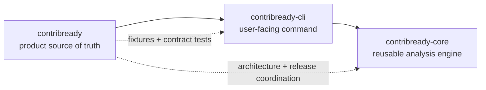

  

  <strong>Can an outside contributor find enough evidence to understand, install, test, modify, and validate this project?</strong> 
  ContribReady reports bounded evidence, explainable findings, and actionable next steps.

 

  
  
  

# ContribReady

ContribReady is a deterministic, local-first contributor-readiness auditor that evaluates whether an outside contributor can understand, install, test, modify, and validate a repository or issue using bounded evidence and explainable findings.

It audits documented evidence—setup, testing, contribution workflow, support/security guidance, and issue specificity—and produces explainable findings and recommendations. It does not predict contributor success, judge software quality, replace maintainers, scan for vulnerabilities, or certify that instructions, CI, or contact channels work.

## Start here

| If you want to… | Start with… |
|---|---|
| Understand the product and architecture | [Documentation map](docs/README.md) · [Architecture](docs/ARCHITECTURE.md) · [Requirements](docs/REQUIREMENTS.md) |
| Run the CLI | `npx --yes @contribready/cli audit .` · [CLI repository](https://github.com/ContribReady/contribready-cli) |
| Understand the analysis engine | [`@contribready/core`](https://www.npmjs.com/package/@contribready/core) · [Core repository](https://github.com/ContribReady/contribready-core) |
| Review safety boundaries | [Security threat model](docs/SECURITY_THREAT_MODEL.md) |
| See how results are tested | [Fixture catalog](docs/FIXTURE_CATALOG.md) · [Contract tests](tests/contract.test.mjs) |
| Contribute or propose funded work | [Contributing](CONTRIBUTING.md) · [Grant submission guide](docs/GRANT_SUBMISSION.md) |

## The repository family

This repository is the product source of truth. The local parent folder is only a navigation container, not a fourth repository. The product has three clear ownership boundaries:

- [`contribready`](https://github.com/ContribReady/contribready): product direction, documentation, fixtures, contract tests, and release coordination.
- [`contribready-cli`](https://github.com/ContribReady/contribready-cli): user-facing command and optional GitHub adapter.
- [`contribready-core`](https://github.com/ContribReady/contribready-core): reusable analysis engine.

The parent workspace is only a navigation folder. It is not a fourth repository. See the [repository map](docs/REPOSITORY_MAP.md) for the exact boundary decisions.

## Why it is useful

Contributor experience is part of project quality. A repository can have working code and still be difficult to enter because setup, testing, contribution, security, or issue expectations are missing. ContribReady makes documented evidence reviewable without executing the target project; maintainers remain responsible for interpreting findings.

## v0.1 promise

Static local repository audits and local Markdown issue audits are deterministic, safe, and explainable. No arbitrary repository code, package install script, test suite, network request, or AI judgment is required for the default audit.

See [PROJECT_STATE.md](PROJECT_STATE.md), [ROADMAP.md](ROADMAP.md), [docs/REQUIREMENTS.md](docs/REQUIREMENTS.md), and the latest [independent audit](AUDIT_REPORT.md).

## Submission and repository map

For the exact ownership boundaries and local layout, see [docs/REPOSITORY_MAP.md](docs/REPOSITORY_MAP.md). For grant-facing preparation, see [docs/GRANT_SUBMISSION.md](docs/GRANT_SUBMISSION.md). The main repository is the product and submission entry point; Core is the reusable engine; CLI is the executable product.

## Status

The 2026-10-18/19 source review found that earlier “phase complete” labels overstated verification. A maintainer-led clean-checkout walkthrough passed, but it was not an independent blind study. On 2026-10-20, bounded evidence from five pinned public repositories was used to calibrate rules, and setup/test findings gained an explicit `documented` / static metadata `consistent|conflicting|not-assessed` / `execution: not-run` distinction. The Core and CLI changes passed Node 20/22/24 × Ubuntu/Windows/macOS and were merged through protected pull requests. `@contribready/core@0.1.0` and `@contribready/cli@0.1.0` are public on npm; a fresh-cache `npx --yes @contribready/cli@0.1.0 audit ... --format json` run installed from the registry and completed successfully. Real-world calibration remains bounded and no impact, adoption, or objective contributor-friendliness claim is made. See the [external evidence and release review](docs/EXTERNAL_EVIDENCE_AND_RELEASE_REVIEW_20261020.md), [current readiness review](docs/READINESS_REVIEW_20261018.md), and [walkthrough record](docs/CONTRIBUTOR_WALKTHROUGH_20261019.md); [FINAL_AUDIT.md](FINAL_AUDIT.md) is a historical v0.1 audit.

## License

All three public repositories now contain the complete MIT license, their applicable package metadata agrees, and GitHub reports `MIT` on each default branch. See the [current readiness review](docs/READINESS_REVIEW_20261018.md) and [license/security remediation history](docs/LICENSE_AND_SECURITY_REMEDIATION.md).
